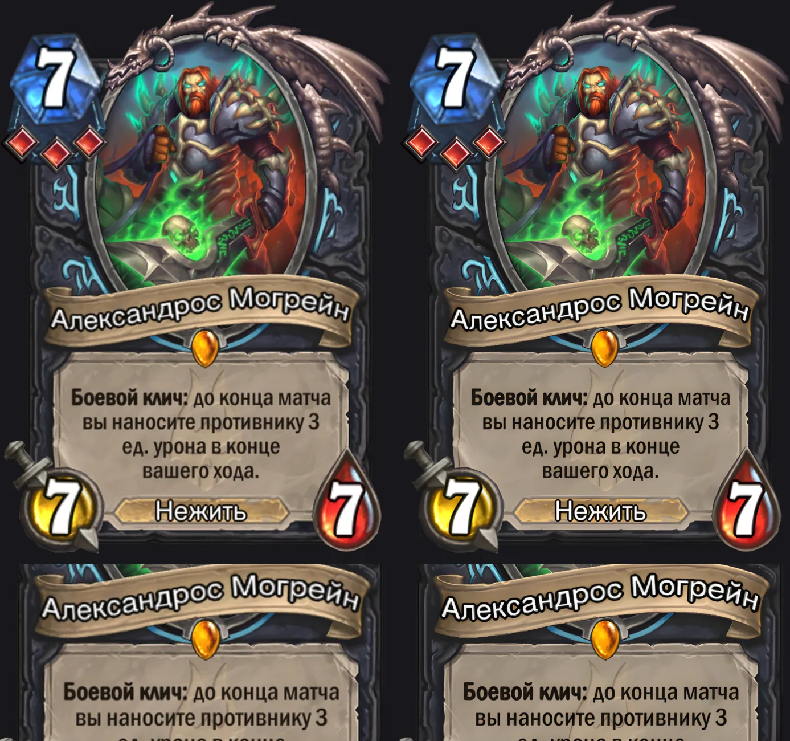
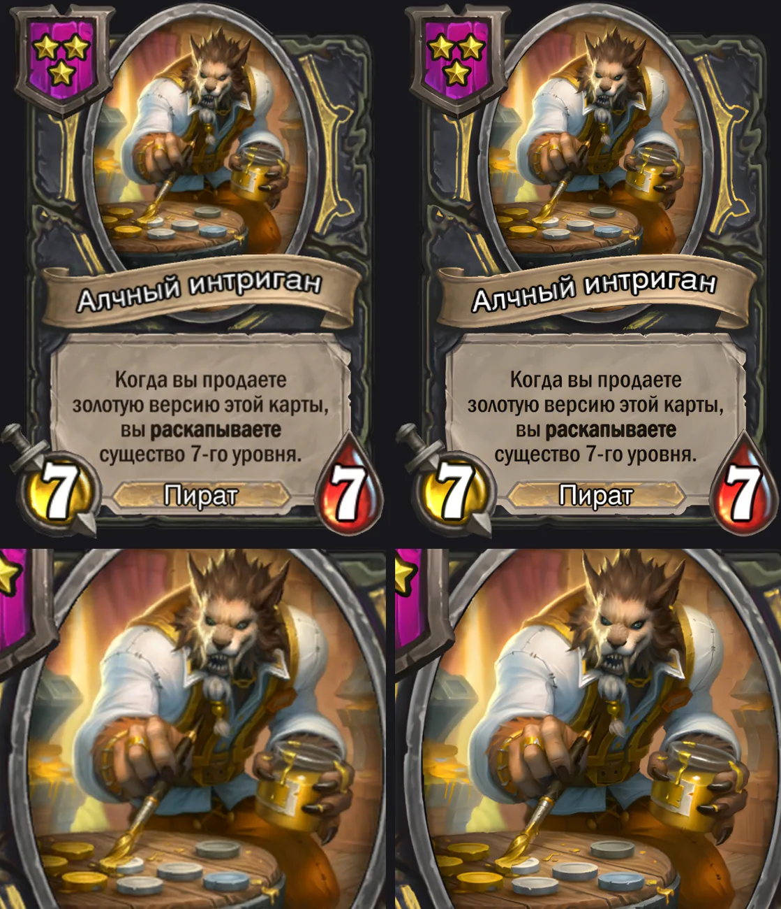
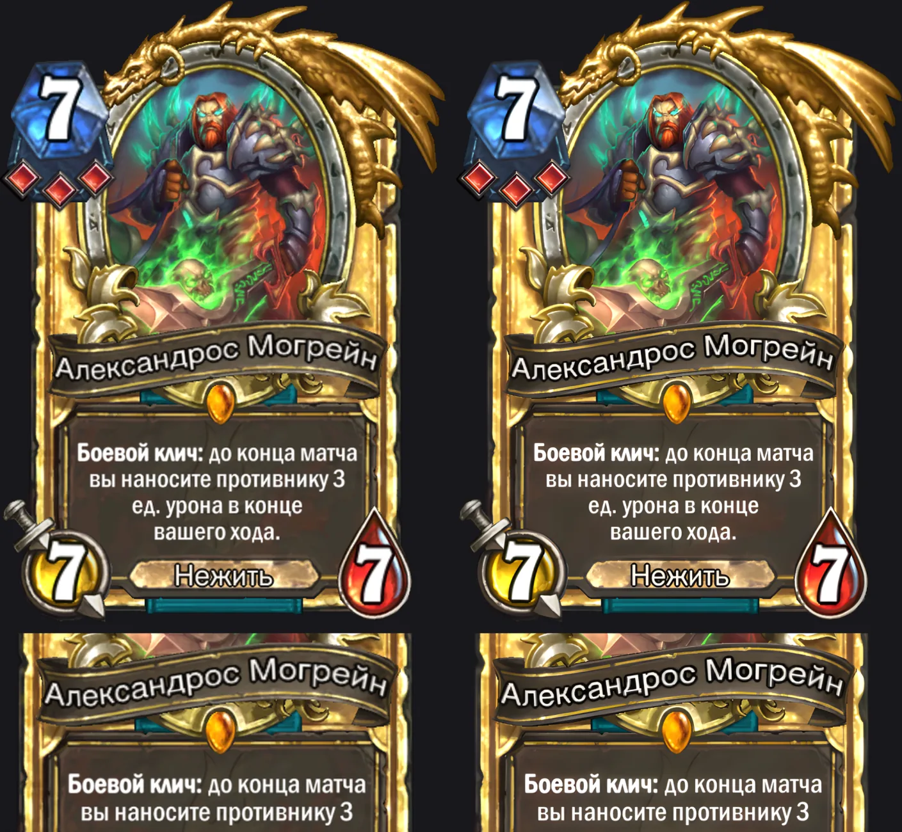
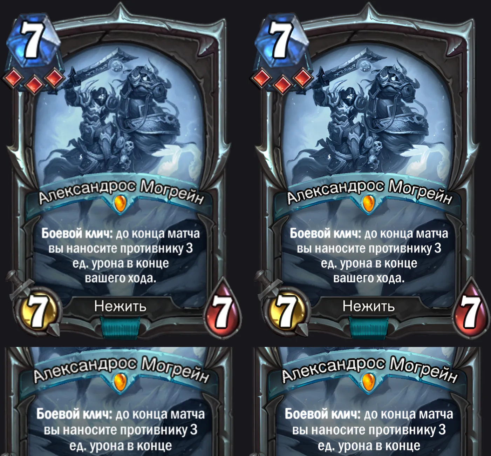
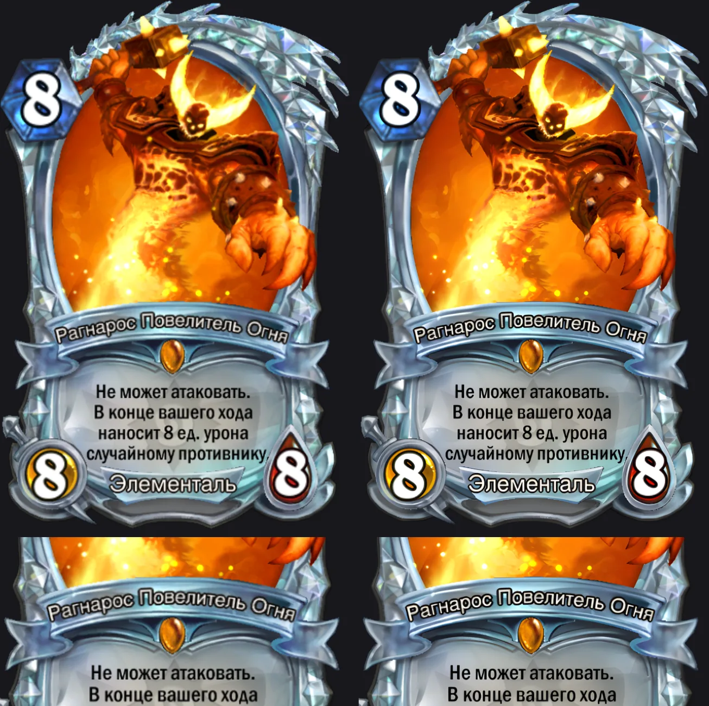
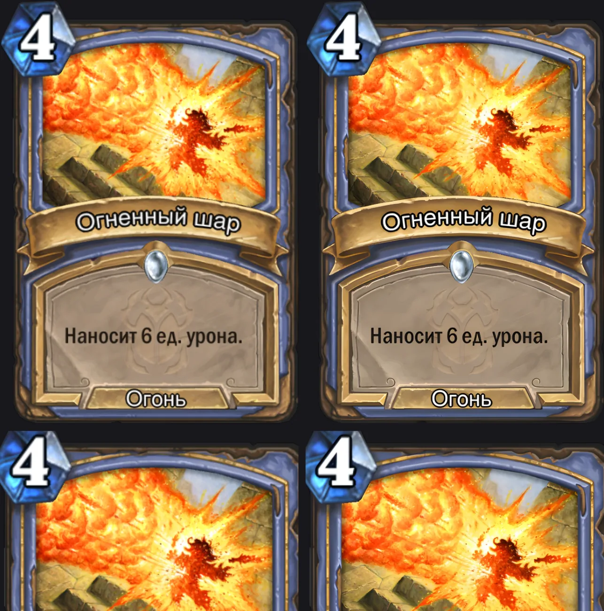
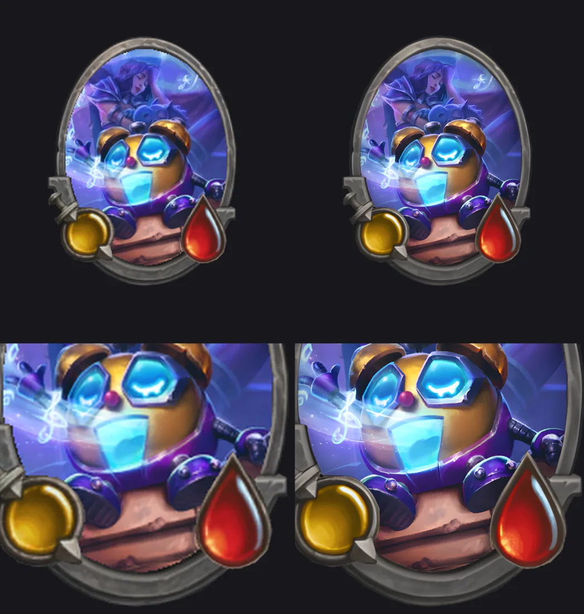
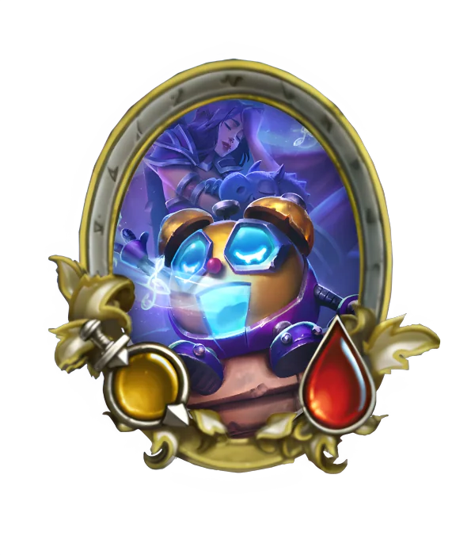
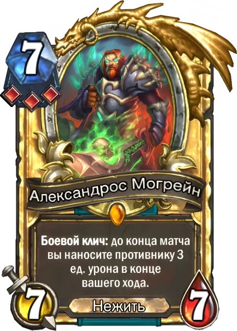

# card-v2

Утилита собирает изображения карт Hearthstone в высоком разрешении из существующих рендеров
512 px. Сама карты не рисует: берёт готовый рендер, увеличивает его нейросетью Real-ESRGAN в 4 раза
и, где это улучшает результат, подставляет под рамку исходный арт.

Рассчитана на вызов из скриптов и ИИ-агентами: каждая команда печатает в stdout ровно один объект
JSON на результат. Правила для агентов — в [AGENTS.md](AGENTS.md).

## Сравнение

На каждой картинке слева исходник, растянутый до размера результата, справа результат. Нижний
ряд — тот же участок крупно. Все картинки собраны командой `cardv2 compare`.

### Обычная карта

Исходник 512 px, результат 1000 px, арт подставлен из отдельного файла.



### Поля сражений



### Золотая, сигнатурная, бриллиантовая

У этих вариантов арт не подставляется: карта увеличивается целиком.







### Заклинание



### Существо на столе

Исходник 300 px, результат 1200 px. Справа — золотая рамка.

 

### Анимированная золотая карта

Движение арта взято из видео 286 px и перенесено на карту высокого разрешения; рамка и текст
неподвижны. Здесь показан вариант 480 px в анимированном WebP.



## Что умеет

| Команда | Что делает | Проверено на |
|---|---|---|
| `hand` | Карта в руке: обычная, золотая, сигнатурная, бриллиантовая; обычные режимы и Поля сражений | существа всех вариантов, заклинание, существо Полей сражений |
| `onboard` | Существо «на столе»: овальная рамка с пустыми камнями, обычная и золотая | одно существо |
| `animate` | Анимированная карта: движение арта из маленького видео переносится на HD-карту | одна золотая карта |
| `batch` | Много карт `hand` подряд с одной загруженной моделью, с пропуском готовых | четыре карты разных вариантов |
| `ids` | Список всех коллекционных карт или пула Полей сражений для `batch` | настоящий каталог: 8328 и 682 карты |
| `compare` | Картинка «до и после» с увеличенным фрагментом | картинки этого README |
| `doctor` | Показывает, что установлено и готово к работе | запуск на сервере |

## Установка

Нужен Python 3.10+. Для `animate` нужен `ffmpeg` в `PATH`.

```bash
python3 -m venv .venv
.venv/bin/pip install -e '.[upscale]'      # torch + spandrel
.venv/bin/cardv2 doctor
```

На машине без видеокарты ставьте CPU-сборку torch, она в разы меньше:

```bash
.venv/bin/pip install torch --index-url https://download.pytorch.org/whl/cpu
.venv/bin/pip install -e '.[upscale]'
```

Веса модели (67 МБ) скачиваются при первом запуске в кеш и проверяются по SHA-256.

## Примеры

```bash
# обычная карта на русском, 1000 px по ширине; формат задаёт расширение: .png или .webp
cardv2 hand RLK_706 --out out/RLK_706.png
cardv2 hand RLK_706 --out out/RLK_706.webp --quality 88

# золотая, сигнатурная, бриллиантовая
cardv2 hand RLK_706 --variant golden    --out out/RLK_706_golden.png
cardv2 hand RLK_706 --variant signature --out out/RLK_706_signature.png
cardv2 hand EX1_298 --variant diamond   --out out/EX1_298_diamond.png

# Поля сражений
cardv2 hand BG36_369 --mode bg --out out/BG36_369.png

# свой рендер вместо источника по умолчанию (файл или https-адрес)
cardv2 hand EX1_298 --render /path/to/official.png --out out/EX1_298.png

# существо на столе, обычное и золотое
cardv2 onboard BG26_146 --out out/BG26_146_board.png
cardv2 onboard BG26_146 --golden --out out/BG26_146_board_golden.png

# анимированная золотая: нужно маленькое видео той же карты
cardv2 animate RLK_706 --video https://example.com/RLK_706-golden.webm \
    --out-dir out/ --formats webm,webp,mp4

# все карты: список из каталога, затем пакетная сборка в WebP
cardv2 ids --kind collectible --out ids.txt
cardv2 ids --kind bg --with-golden --out ids-bg.txt
cardv2 batch --ids-file ids.txt --out-dir out/ --format webp

# картинка «до и после»
cardv2 compare --before https://static.firestoneapp.com/cards/ruRU/512/RLK_706.png \
    --after out/RLK_706.png --out compare.webp --zoom 0.03,0.50,0.97,0.80
```

Основные параметры: `--locale ruRU`, `--width 1000` (0 — родные 4x), `--source firestone|hsjson`,
`--device auto|cpu|cuda`, `--threads N`, `--tile N` (обработка плитками при нехватке памяти),
`--no-cache`. Полный список: `cardv2 <команда> --help`.

## Проверка «точь-в-точь»

Каждый результат `hand`, `onboard` и `animate` сравнивается со своим исходником: результат
уменьшается обратно до размера исходника, обе картинки слегка размываются, и считается разница
цвета по шкале 0–255. Размытие нужно, чтобы резкость не считалась отличием — остаётся только
изменение содержимого.

В JSON это поле `fidelity`:

- `mean_diff` — средняя разница по всей карте, предел 6;
- `region_diff` — разница в худшем участке 24×24 px исходника, предел 18;
- `faithful` — уложился ли результат в оба предела.

При превышении в `warnings` появляется `"fidelity"`, а файл всё равно записывается: это
предупреждение, а не ошибка. Пределы подобраны по восьми сборкам (точные дали 3,4–4,8 и 5,2–13,3)
и меняются параметрами `--max-diff` и `--max-region-diff`.

Проверка уже окупилась: на одной карте арт при подстановке залез на рамку и затёр руну, худший
участок показал 50 при обычных 5–13. Причина исправлена, случай закреплён тестом.

## Как это работает

**`hand`.** Рендер 512 px увеличивается в 4 раза; цвет и прозрачность проходят через модель
раздельно. Для обычного варианта утилита находит на карте арт (совмещение по центру арта в
нескольких масштабах, с точностью до долей пикселя), подгоняет цвета и подставляет увеличенный
исходный арт 512 px там, где карта действительно показывает арт. Область арта определяется по
двум признакам сразу — цвету и рисунку, — поэтому рамка, название и камни поверх арта не
затрагиваются, даже если совпадают с артом по цвету. Подстановка выполняется, только если
совпадение не ниже `--min-art-score` (0,95). Для золотых, сигнатурных и бриллиантовых она
отключена: у них свой арт или свой отблеск, и подстановка ухудшала результат.

**`onboard`.** Рамка 300×350 увеличивается в 4 раза, арт кладётся в её овальное окно по
фиксированным координатам.

**`animate`.** Из видео берётся «поза покоя» (медиана кадров). Для каждого кадра считается
оптический поток относительно неё; HD-арт сдвигается по этому потоку, поверх добавляется
изменение яркости из видео (свечение, пламя). Видео и HD-карта совмещаются через общий арт,
поэтому у них могут быть разные раскладки и языки. Вне окна арта карта неподвижна. Чтобы петля
не дёргалась, последние кадры плавно вмешиваются в первые (`--loop-blend`, по умолчанию 8
кадров): на проверенной карте скачок на стыке был в 11 раз больше обычного шага между кадрами,
после сглаживания стал меньше него. Анимация при этом укорачивается на эти кадры.

## Источники

Рендеры, рамки, видео и веса модели в репозитории не хранятся; файлы скачиваются при запуске в
кеш (`CARDV2_CACHE`, по умолчанию `~/.cache/cardv2`). Исключение — картинки сравнения для этого
README в `docs/img`.

| Что | Откуда |
|---|---|
| Рендеры карт 512 px по языкам, все варианты | `static.firestoneapp.com` (Firestone) |
| Рендеры 512 px, только обычные | `art.hearthstonejson.com` (HearthstoneJSON) |
| Арт 512×512 и каталог карт | `art.hearthstonejson.com`, `api.hearthstonejson.com` |
| Рамки «на столе» | `static.zerotoheroes.com` (Firestone) |
| Веса Real-ESRGAN x4plus (BSD-3-Clause) | релиз `xinntao/Real-ESRGAN` на GitHub |

Изображения карт принадлежат Blizzard Entertainment. Перед публикацией результатов проверьте
условия использования этих источников.

## Ограничения

- Резкость дорисована нейросетью. Это не исходники высокого разрешения: мелкая фактура рамок
  сглаживается.
- Рендеры Firestone и HearthstoneJSON — не игровые: название набрано не тем шрифтом, что в
  игре. Чтобы получить игровой вид, передайте официальный рендер через `--render`.
- У сигнатурных карт свой арт; он увеличивается вместе с картой, без подстановки.
- Проверены не все типы карт: оружие, герои и локации не запускались. Подстановка арта сама
  отключается, если арт не найден.
- В `animate` двигается только арт. Блики на рамке не переносятся.
- Пределы проверки «точь-в-точь» подобраны на небольшом числе карт и могут давать ложные
  предупреждения на непроверенных типах.
- Запуск на видеокарте (`--device cuda`) не проверялся: код писался и тестировался на процессоре.

## Скорость

На сервере без видеокарты (8 потоков): увеличение рендера карты `hand` — около минуты, ещё
около полуминуты на арт при подстановке; `onboard` — меньше минуты; перенос движения в
`animate` — около 15 секунд сверх сборки золотой карты. Увеличенные картинки кешируются по
содержимому, повторный запуск той же карты занимает секунды.

## Разработка

```bash
.venv/bin/pip install -e '.[dev]'
make verify PYTHON=.venv/bin/python      # ruff + pytest
```

Тесты не требуют сети, модели и torch: нейросеть в них заменена обычным увеличением. Та же
команда запускается на GitHub при каждом пуше и pull request. Тест кодирования видео
пропускается, если в системе нет `ffmpeg`.
